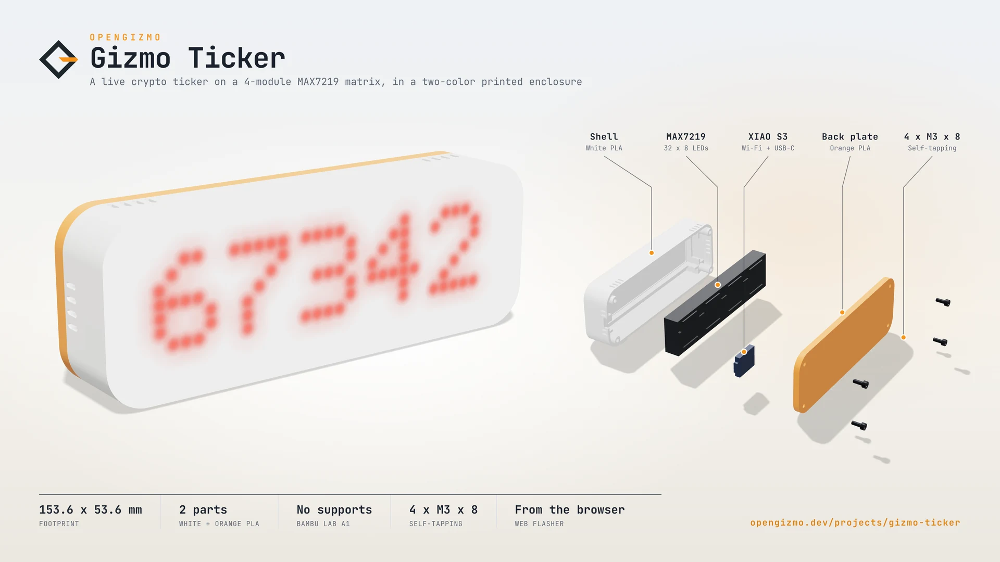
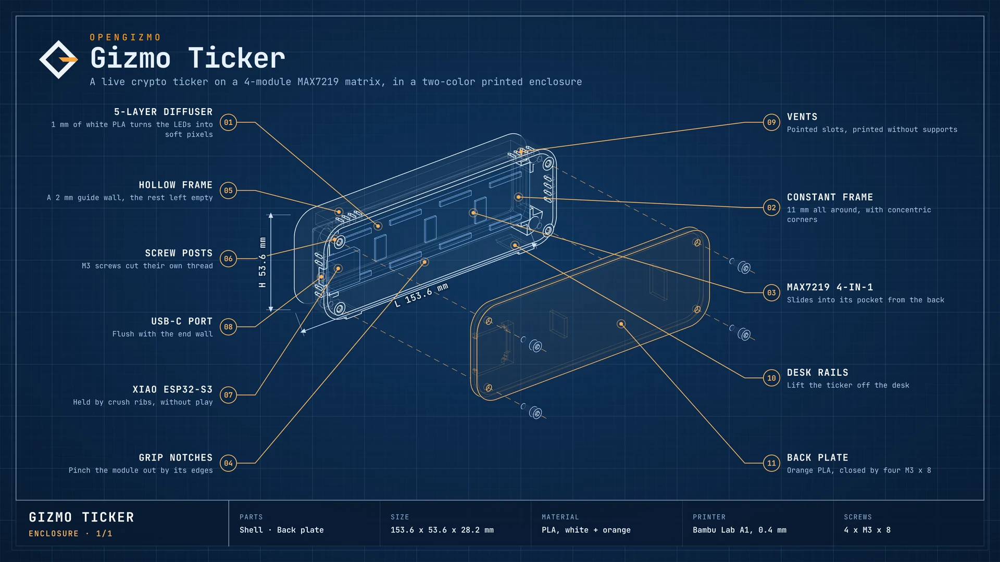
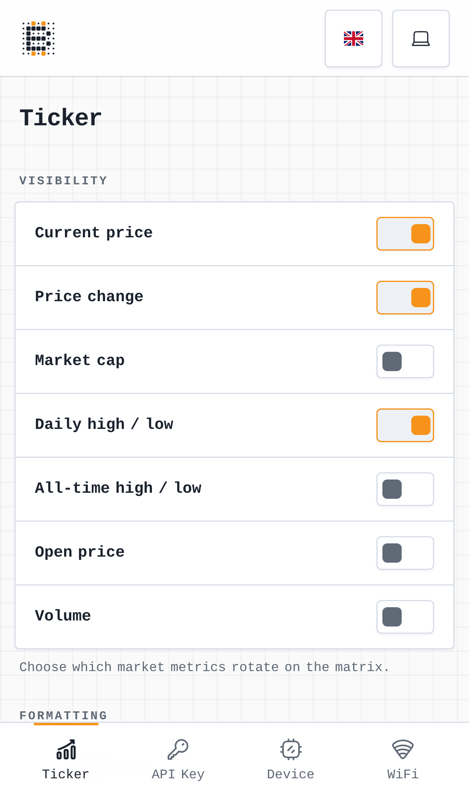
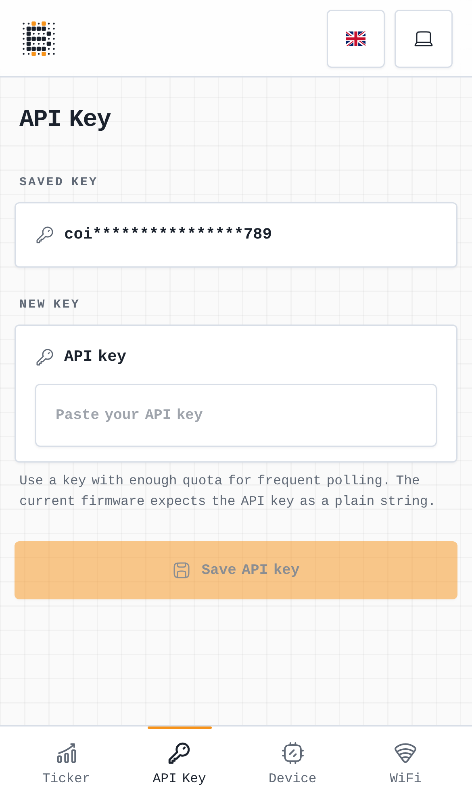
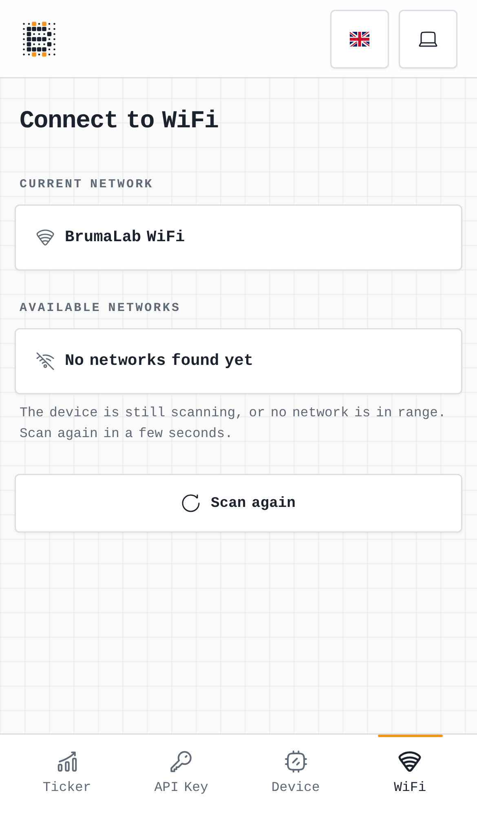

<div align="center">

# 💰 Gizmo Ticker

### A real-time crypto display for ESP32 and MAX7219

Gizmo Ticker is a two-part project for building a WiFi-connected cryptocurrency display with an ESP32 microcontroller, a MAX7219 LED matrix, and a Nuxt 4 web app for configuration.

<p>
  <a href="https://opengizmo.dev/projects/gizmo-ticker"></a>
</p>

<p>
  <a href="https://github.com/open-gizmo/gizmo-ticker"></a>
  
  
  
  
</p>

<p>
  📡 WiFi-connected ticker • 📺 MAX7219 LED matrix output • 🎛️ Web-based setup and settings • 🌍 EN/IT UI • ⚡ Lightweight Nuxt UI
</p>

<p>
	<a href="#enclosure"><strong>Enclosure</strong></a> •
	<a href="#overview"><strong>Overview</strong></a> •
	<a href="#images"><strong>Images</strong></a> •
	<a href="#features"><strong>Features</strong></a> •
	<a href="#architecture"><strong>Architecture</strong></a> •
	<a href="#quick-start"><strong>Quick Start</strong></a> •
	<a href="#hardware"><strong>Hardware</strong></a> •
	<a href="#firmware-overview"><strong>Firmware Overview</strong></a> •
	<a href="#configuration"><strong>Configuration</strong></a> •
	<a href="#troubleshooting"><strong>Troubleshooting</strong></a> •
	<a href="#license"><strong>License</strong></a>
</p>

</div>

<a id="enclosure"></a>
## 📐 Enclosure

<div align="center">
	
	<p>
		<sub>The two-color printed enclosure: a white shell that diffuses the LEDs, and an orange back plate closed by four M3 screws</sub>
	</p>
</div>

<a id="overview"></a>
## 📘 Overview

Gizmo Ticker is built for a very specific kind of maker project: a small always-on crypto display that feels more like a compact appliance than a demo. The ESP32 keeps pulling live market data, the MAX7219 matrix turns it into something visible and immediate, and the Nuxt app gives you a clean place to configure the device without needing to reflash firmware for every adjustment.

The result is a practical two-part system that is easy to set up, easy to tweak, and easy to leave running on a desk, shelf, or workbench. You can use it as a daily crypto glance board, a weekend hardware project, or a template for building other connected displays with the same firmware-plus-web-app workflow.

Behind the scenes, the firmware and web app stay aligned through the same settings model, so changes made in the browser match what the ESP32 expects at runtime. That keeps the experience predictable: the web UI configures the device, the firmware fetches and renders the values, and the matrix shows the current data in a simple, readable format.

<a id="images"></a>
## 🖼️ Images

### Screenshots

<div align="center">
	<table>
		<tr>
			<td align="center" valign="top">
				
			</td>
			<td align="center" valign="top">
				
			</td>
			<td align="center" valign="top">
				
			</td>
		</tr>
	</table>
	<p>
		<sub>WiFi setup, settings, API key, and full app preview screens</sub>
	</p>
</div>


<a id="features"></a>
## ✨ Features

- Live cryptocurrency data on a MAX7219 LED matrix.
- ESP32 firmware with WiFi setup, settings stored in flash, and embedded HTTP configuration.
- Web-based configuration for WiFi credentials, API key, and display settings.
- Adjustable scroll speed, selected metrics, and matrix behavior.
- Nuxt 4 interface that mirrors the firmware configuration flow.
- `@brumaombra/ui-vintage` UI system shared across layout, forms, dialogs, and overlays.
- English and Italian localization with browser language detection.
- Captive-portal setup flow in AP mode and `gizmo-ticker.local` hostname access after joining WiFi. The API only answers the dashboard's own page, under the ticker's own name or address, and through the setup hotspot only the Wi-Fi setup.
- Factory reset: hold the board's BOOT button for 10 seconds while it runs to forget the Wi-Fi and the settings, and start again from the setup hotspot.

<a id="architecture"></a>
## 🏗️ Architecture

Gizmo Ticker is built around three cooperating parts:

- 🔌 **ESP32 firmware** handles WiFi, data fetching, settings storage, and the embedded HTTP server.
- 📺 **MAX7219 LED matrix** displays the live crypto ticker output.
- 🌐 **Nuxt web app** provides the browser-based setup and configuration interface with theme, language, and shared UI-system support.

### 🔄 Data Flow

1. The web app sends configuration changes to the ESP32 over HTTP.
2. The firmware stores settings and fetches cryptocurrency market data from external APIs.
3. The matrix renders the current values as scrolling text.

<a id="quick-start"></a>
## 🚀 Quick Start

### 🚀 Easy, no-code option

Use this path if you just want to flash the prebuilt firmware from the website. You do not need VS Code, PlatformIO, or a local build step.

1. **Connect your ESP32 to an available USB port on your PC.**

2. **Open the [Gizmo Ticker](https://opengizmo.dev/projects/gizmo-ticker) project page.**

3. **Scroll down until you reach the firmware flashing card.**

4. **Press the "Flash firmware" button in the card to start the upload.**

5. **Wait until the flashing process completes.**

6. **Enjoy your Gizmo Ticker!**

### 🛠️ More technical option

If you want to build and flash everything yourself, follow this path:

1. **Install Visual Studio Code and PlatformIO.**

	Open the repository in VS Code, then install the PlatformIO extension so you can build and upload the firmware from the editor. The firmware project lives in `microcontroller/`, and PlatformIO uses the settings defined in `microcontroller/platformio.ini`.

2. **Build the app UI first.**

	The web app lives in `webapp/` and needs Node.js 24.21 or newer. From that folder, install the exact dependencies of the lockfile and build the embedded UI bundle:

	```bash
	npm ci
	npm run build:embedded
	```

	This runs the Nuxt static build, then the `gizmo-embed` tool from [gizmo-common](https://github.com/open-gizmo/gizmo-common) turns it into gzipped C++ assets for the firmware. Re-run it any time you change the web UI, translated labels, or embedded pages.

3. **Build the microcontroller code.**

	Open `microcontroller/` in PlatformIO and run the firmware build. From the CLI, the equivalent command is:

	```bash
	pio run
	```

	This compiles the firmware for the XIAO ESP32-S3 together with the current web UI assets and the libraries declared in `platformio.ini`.

4. **Upload the firmware to the ESP32.**

	After a successful build, upload the firmware to the board from the PlatformIO toolbar or with:

	```bash
	pio run --target upload
	```

	Make sure the ESP32 is connected over USB before uploading. If the board does not start correctly after flashing, open the serial monitor to check boot logs:

	```bash
	pio device monitor
	```

	The released firmware keeps the serial log off. To see it, flash the `debug` build profile (see [Build profiles](#build-profiles)):

	```bash
	pio run -e debug --target upload
	pio device monitor
	```

<a id="hardware"></a>
## 🔌 Hardware

### Board

The firmware targets the **Seeed Studio XIAO ESP32-S3** (PlatformIO board `seeed_xiao_esp32s3`), the board of the OpenGizmo enclosure.

The XIAO has no antenna on the board: connect its FPC antenna to the U.FL connector, or it won't join the Wi-Fi.

### Pinout

| MAX7219 input | XIAO ESP32-S3 |
| --- | --- |
| VCC | `5V` |
| GND | `GND` |
| DIN | `D10` (GPIO9, MOSI) |
| CS | `D9` (GPIO8) |
| CLK | `D8` (GPIO7, SCK) |

On the XIAO, the pads next to `5V` and `GND` follow the order of the module input header, so a 6-wire flat cable runs straight across (leave the `3V3` wire unconnected). The display only writes, so the SPI bus starts without MISO, and `D9` is free for CS.

### Display

- Type: `MAX7219 LED matrix`
- Hardware layout: `FC16_HW`
- Modules: 4 to 32 (8 × 8 blocks, in 4-in-1 boards), set in the web app's settings; the ticker restarts to use a new number

<a id="firmware-overview"></a>
## 🔍 Firmware Overview

### ⚙️ General

The firmware is responsible for the runtime behavior of the physical ticker.

- Connects the ESP32 to WiFi.
- Persists settings in flash with `Preferences` (one key per setting).
- Hosts the embedded HTTP server.
- Fetches and parses cryptocurrency market data.
- Renders scrolling text to the MAX7219 matrix.
- Serves the embedded web UI assets.
- Keeps AP setup available during onboarding and exposes `gizmo-ticker.local` on supported networks after joining WiFi.

### 🧩 Firmware Layers

The firmware is split into focused modules under `microcontroller/src/`:

- 📡 `api/` handles market data fetching (`market_refresh.*` decides when to fetch, `market_data.*` reads the CoinGecko reply).
- ⚙️ `config/` centralizes settings, defaults, and validation.
- 📺 `matrix/` manages LED output and scrolling text.
- 🌐 `server/` exposes the embedded HTTP routes (`settings_json.*` maps the settings to and from the API JSON).
- 💾 `storage/` stores settings in flash with `Preferences`.
- 🔌 `wifi/` gives the ticker's names to the shared Wi-Fi setup and shows its status on the matrix.

### 🧪 Tests

The hardware-free logic (the settings format of the web API, when to fetch the market data, and how its reply is read) is tested on your computer, no board needed:

```bash
cd microcontroller
pio test -e native
```

The tests live in [microcontroller/test/](microcontroller/test/). They also run in the release workflow before the firmware is built.

The web app has its own tests (its pages, the mock device API and the translations), with Vitest:

```bash
cd webapp
npm test
```

They live in [webapp/tests/](webapp/tests/), and [webapp/tests/README.md](webapp/tests/README.md) explains how they are built.

Logging, number formatting, the web API helpers and the whole Wi-Fi setup (connection, setup hotspot, captive portal, and the `/api/networks`, `/api/connect` and `/api/check-connection` endpoints) come from the shared [gizmo-common](https://github.com/open-gizmo/gizmo-common) library, which has its own tests.

### 🌐 Web App Overview

The Nuxt app provides the browser-based device configuration interface.

- Mirrors the firmware settings model.
- Lets users configure WiFi and API credentials.
- Controls display behavior and matrix preferences.
- Supports English and Italian localization.
- Uses the `@brumaombra/ui-vintage` package for the shared design system.
- Includes library-managed busy, confirm, and message flows for critical actions.
- Keeps device API helpers, theme state, and crypto-accent logic in `webapp/app/composables/`.
- Uses static generation for the embedded web UI bundle that is packaged into firmware assets.

#### 🎨 UI System

The web app splits UI responsibilities between the shared packages and the app itself.

- `@brumaombra/ui-vintage` provides the reusable UI system.
- The gizmo-common web layer provides the dashboard layout, the Wi-Fi pages, the device card, and the mock device for the Wi-Fi and device routes.
- `webapp/app/pages/ticker.vue` is the ticker page (what the matrix shows), `webapp/app/pages/api-key.vue` the API key page, `webapp/app/pages/device.vue` holds the device card, and `webapp/app/app.config.ts` sets the name, logo and navigation for the layer.
- `webapp/app/assets/css/main.css` imports the shared library and layer stylesheets, then layers the crypto accent colors on top.
- `webapp/app/composables/useUtils.js` and `webapp/app/composables/stores/useGlobalStore.js` keep the crypto coin selection and the device-backed state local to the app.

<a id="configuration"></a>
## ⚙️ Configuration

### Build profiles

[platformio.ini](microcontroller/platformio.ini) has the same three profiles as every OpenGizmo firmware:

- `release`, the default: the firmware the release workflow builds and the website flashes, with the serial log off.
- `debug`: the same firmware with the serial log on, and the ESP32 core's own messages. Flash it with `pio run -e debug --target upload`, then open `pio device monitor`.
- `native`: the tests of the hardware-free logic, on your computer (`pio test -e native`).

Nothing needs a secrets file: the Wi-Fi, the API key and the settings are set from the phone and saved on the board.


### Device Settings

The ticker keeps its runtime settings in a shared `DeviceConfig` model defined in `microcontroller/src/config/config.h` and initialized in `microcontroller/src/config/config.cpp`.

The main adjustable values are:

- which market sections are visible on the matrix
- the selected crypto coin
- the number formatting style (`US` or `EU`)
- matrix intensity
- scroll speed
- WiFi credentials
- API key for market data requests

### Firmware Defaults

The firmware starts with a practical default configuration:

- all market sections enabled
- `bitcoin` as the default coin
- US-style number formatting
- a moderate matrix intensity
- a readable scroll speed for the LED matrix

### Runtime Flow

The device is configured through its embedded web UI and local network flow.

1. The ESP32 starts in access point mode on first boot.
2. The web app lets you edit the ticker settings in the browser.
3. The firmware stores the settings locally and reuses them after reboot.
4. The device can then be reached on the local network using `gizmo-ticker.local` on supported setups.

### Key Files

- `microcontroller/src/config/config.h` for the device config structure and hardware constants.
- `microcontroller/src/config/config.cpp` for defaults and runtime state.
- `webapp/app/composables/stores/useGlobalStore.js` for shared UI and device-backed state.
- `webapp/app/composables/useDeviceApi.js` for browser-to-device communication.

### Releasing a new version

Versions follow [semantic versioning](https://semver.org) (`vMAJOR.MINOR.PATCH`), in the `VERSION` file: a bug fix bumps the patch (1.0.1), a new feature that keeps the saved settings bumps the minor (1.1.0), and a change that resets the settings or needs new wiring bumps the major (2.0.0).

1. On `feature`, set the new version in `VERSION` and in `webapp/package.json` (`npm version X.Y.Z --no-git-tag-version` in `webapp/` updates its lockfile too).
2. Bring `main` up to `feature`.
3. Run the **Build & Release 📦** workflow by hand (Actions > Build & Release > Run workflow, on `main`). It checks the version is new and matches the web app, runs the tests, builds the web app and the firmware (which reports its version in `/api/device`), and creates the GitHub Release `vX.Y.Z` with the four flash parts and notes from the commits.
4. The same parts go to Cloudflare R2, with a `manifest.json` that lists each part and its flash address. The flash button on [opengizmo.dev](https://opengizmo.dev/projects/gizmo-ticker) reads that manifest, so it always installs the latest release, and keeps the saved settings. The CDN caches the manifest for 60 seconds only, so the website offers a new release within a minute, with no purge.

The workflow only runs on `main`, and needs these secrets, on the repository or on the open-gizmo organization: `R2_ACCOUNT_ID`, `R2_ACCESS_KEY_ID`, `R2_SECRET_ACCESS_KEY` (an R2 API token limited to the bucket) and `R2_BUCKET`. It checks them first, and stops before releasing anything when one is missing.

<a id="troubleshooting"></a>
## 🧰 Troubleshooting

- The LED matrix powers on but shows no text: verify the MAX7219 wiring against the pinout above, check that the matrix is using the `FC16_HW` layout, and that the number of modules in the settings matches the display.
- The web UI does not open after joining WiFi: make sure the ESP32 is connected to the same network and try the `gizmo-ticker.local` hostname if your router supports mDNS.
- The ticker does not update with new prices: confirm the WiFi credentials and the market data API key are saved correctly in the setup flow.
- The matrix shows `Prices from N min ago` before the prices: the last fetches failed for more than 12 minutes, so the prices on screen are old. The rest of the message says why (for example a wrong API key or no internet). Saving a new API key fetches again right away.
- The display scrolls too fast or too slow: adjust the scroll speed in the web configuration and rebuild the embedded assets if needed.
- The AP setup flow never appears: power-cycle the device and check the firmware logs for WiFi connection errors or saved configuration issues.

<a id="license"></a>
## 📄 License

This project is licensed under the MIT License. See [LICENSE](LICENSE) for details.

---

<p align="center">
	
	<br/>
	<strong>Real projects. Real hardware. Real fun.</strong>
	<br/>
	<sub>A small corner of the internet for ESP32 builds that are useful, remixable, and actually fun to use.</sub>
</p>